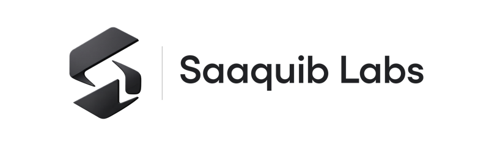
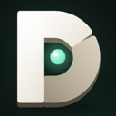
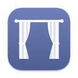

  <a href="https://saaquiblabs.com">
    <picture>
      <source media="(prefers-color-scheme: dark)" srcset="img/lockup-ivory.png">
      
    </picture>
  </a>

<h3 align="center">Here to help. Built to be useful.</h3>

  Small, careful software for the communities big platforms overlook.

  
  

---

## What we have shipped

<table>
  <tr>
    <td width="72" align="center"></td>
    <td>
      <b><a href="https://mihrabummah.com">MihrabUmmah</a></b> · flagship 
      Madrasa graduates (Aalim, Hafiz, Qaari, Mufti) listed by credential and city across India,
      so a masjid that needs an Imam, or a family that needs a Quran teacher, can find one nearby.
    </td>
  </tr>
  <tr>
    <td align="center"></td>
    <td>
      <b><a href="https://d-tox.saaquiblabs.com">D-Tox</a></b> · Chrome extension · <a href="https://github.com/saaquiblabs/d-tox">repo</a> 
      YouTube for what you came for. Nothing else. Hides the Home feed, Shorts, recommendations and
      autoplay. Free, open source, sends nothing.
    </td>
  </tr>
  <tr>
    <td align="center"></td>
    <td>
      <b><a href="https://github.com/saaquiblabs/lost-buttons">Lost Buttons</a></b> · macOS 
      Your mouse's side buttons, back on the Mac. Finds the Back and Forward buttons macOS drops
      and makes them work. <code>brew install saaquiblabs/tap/lost-buttons</code>
    </td>
  </tr>
  <tr>
    <td align="center"></td>
    <td>
      <b><a href="https://github.com/saaquiblabs/curtain">Curtain</a></b> · macOS · early 
      Brightness for every screen, and a curtain to switch any of them off. A menu bar app.
    </td>
  </tr>
</table>

## How we work

- **Research first.** We read primary sources before we write code, and keep what we found next to the code.
- **Every claim cited.** A number on our pages links to where it came from. If we can't source it, we don't say it.
- **Decisions logged.** Each choice gets a short record: what we chose, why, and what we turned down.

Everything here is free and open source unless it says otherwise. Found a bug or have an idea?
Open an issue on the product's repo, or write to [hello@saaquiblabs.com](mailto:hello@saaquiblabs.com).

Founded by <a href="https://najmushsaaquib.com">Najmush Saaquib</a>.
